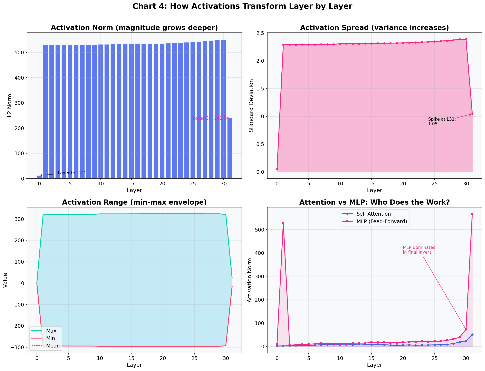
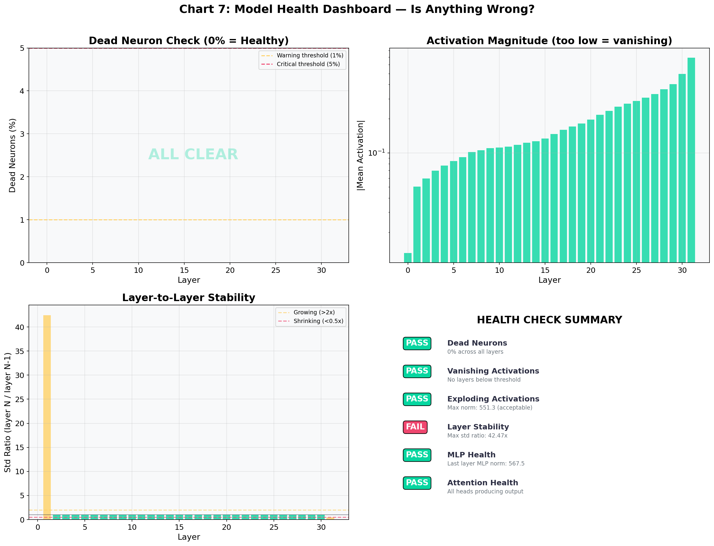
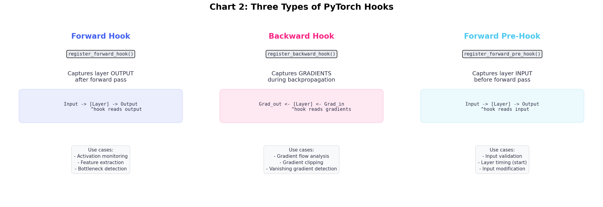
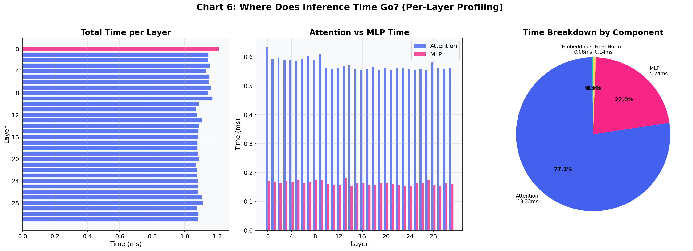

# LLM Mechanistic Interpretability & Neural Steering

[](LICENSE)
[](pyproject.toml)
[](https://pytorch.org/)
[](https://huggingface.co/meta-llama/Llama-3.1-8B-Instruct)

A production-grade mechanistic interpretability and representation engineering framework for large language models. This repository implements techniques to reverse-engineer transformer internals, inspect residual stream representations, detect layer redundancies, and steer autoregressive generation at test-time without weight fine-tuning.

---

## 📑 Table of Contents
1. [Core Features](#-core-features)
2. [Interactive System Architecture](#-interactive-system-architecture)
3. [Visual Diagnostics & Findings](#-visual-diagnostics--findings)
4. [Mathematical & Theoretical Foundations](#-mathematical--theoretical-foundations)
5. [Repository Structure](#-repository-structure)
6. [Quickstart & Python SDK](#-quickstart--python-sdk)
7. [Notebook Curriculum](#-notebook-curriculum)
8. [CLI Tooling](#-cli-tooling)
9. [Running Tests](#-running-tests)
10. [License](#-license)

---

## 🚀 Core Features

- **Memory-Safe Hook Engine (`HookManager`)**: Clean PyTorch forward and backward hook lifecycle management with auto-cleanup context managers preventing memory leaks during extended training or inference loops.
- **Logit Lens & Tuned Lens (`LogitLens`)**: Projects intermediate layer hidden states directly through the unembedding matrix $W_U$, observing how vocabulary probability distributions crystallize layer-by-layer.
- **Outlier Feature Detection (`OutlierDetector`)**: Identifies high-magnitude coordinates (>6 standard deviations) across residual dimensions, diagnosing quantization bottlenecks as formulated in Dettmers et al. (LLM.int8()).
- **Centered Kernel Alignment (`CKAAnalyzer`)**: Computes linear CKA similarity matrices across all 32 transformer layers using Hilbert-Schmidt Independence Criterion (HSIC), identifying redundant blocks suitable for model pruning.
- **Direct Logit Attribution (`DirectLogitAttribution`)**: Decomposes final output logits into exact additive contributions from individual attention heads and MLP blocks.
- **Runtime Activation Steering (`ActivationSteering`)**: Extracts contrastive persona and behavioral steering vectors ($\hat{v} = \mu_{\text{pos}} - \mu_{\text{neg}}$) and injects them directly into the residual stream at test-time with configurable intensity $\alpha$.

---

## 🏛 Interactive System Architecture

The end-to-end diagnostics and steering pipeline is mapped below. For an interactive visual explorer with pan/zoom and trace routes, see [`docs/interpretability_diagram.html`](docs/interpretability_diagram.html).

```
                      ┌────────────────────────────────────────────────────────┐
                      │              Llama 3.1 8B Transformer                 │
[Input Prompts] ─────►│ Tokenizer ──► Embedding ──► Transformer Blocks (0..31) │──► [Output Logits]
                      └───────────────────────────────┬────────────────────────┘
                                                      │ Forward Hooks
                                                      ▼
                      ┌────────────────────────────────────────────────────────┐
                      │              Diagnostic & Steering Suite               │
                      │                                                        │
                      │  • Logit Lens: Early Unembedding to Vocab Space       │
                      │  • CKA Analyzer: 32x32 Layer Redundancy Matrix         │
                      │  • Outlier Detector: Feature Spike Coordinate Mapping │
                      │  • Neural Steering: x'_l = x_l + alpha * v_l          │
                      └────────────────────────────────────────────────────────┘
```

---

## 📊 Visual Diagnostics & Findings

| Transformer Layer Flow | Activation Health Dashboard |
|:---:|:---:|
|  |  |
| *Evolution of token embeddings across 32 transformer blocks* | *L2 norm, std, and zero-activation statistics per layer* |

| PyTorch Hook Types | Layer Timing & Overhead |
|:---:|:---:|
|  |  |
| *Forward hooks, pre-hooks, and tensor tap points* | *Per-layer execution latency measured with micro-timers* |

---

## 🔬 Mathematical & Theoretical Foundations

For comprehensive derivations, literature citations, and proofs, refer to [`docs/METHODOLOGY.md`](docs/METHODOLOGY.md).

### 1. Residual Stream Formulation
A decoder-only transformer operates as an additive communication bus:
$$x_l = x_{l-1} + a_l(x_{l-1}) + m_l(x_{l-1} + a_l(x_{l-1}))$$
$$\text{logits} = \text{RMSNorm}(x_L) W_U^T$$

### 2. Linear Centered Kernel Alignment (CKA)
Measures representational similarity between layer representations $X$ and $Y$ invariant to orthogonal rotation and isotropic scaling:
$$\text{CKA}(X, Y) = \frac{\|Y^T X\|_F^2}{\|X^T X\|_F \|Y^T Y\|_F}$$

### 3. Contrastive Activation Addition (CAA)
Extracts direction vectors representing latent concepts and applies test-time interventions:
$$\hat{v}_l = \frac{\mu(x_l^+) - \mu(x_l^-)}{\|\mu(x_l^+) - \mu(x_l^-)\|_2}, \quad x'_l = x_l + \alpha \hat{v}_l$$

---

## 📂 Repository Structure

```
.
├── src/
│   └── llm_interpretability/
│       ├── __init__.py           # Package exports
│       ├── hooks.py              # PyTorch forward/backward hook manager
│       ├── logit_lens.py         # Logit Lens unembedding engine
│       ├── outliers.py           # Dettmers LLM.int8 outlier detector
│       ├── cka.py                # Linear Centered Kernel Alignment
│       ├── attribution.py        # Direct Logit Attribution (DLA)
│       ├── steering.py           # Contrastive activation addition & steering
│       └── geometry.py           # PCA/UMAP manifold geometry
├── notebooks/
│   ├── 01_llm_hooks_inference.ipynb        # Hook registration & tensor inspection
│   ├── 02_opening_the_blackbox.ipynb       # Deep residual stream mechanics
│   ├── 03_logit_lens.ipynb                 # Vocabulary projection per layer
│   ├── 04_outlier_features.ipynb           # High-magnitude coordinate discovery
│   ├── 05_layer_redundancy_cka.ipynb       # Layer similarity matrices & pruning
│   ├── 06_token_trajectory.ipynb           # Token velocity in residual space
│   ├── 07_direct_logit_attribution.ipynb   # Attention vs MLP logit decomposition
│   ├── 08_representation_geometry.ipynb    # Concept manifold clustering
│   ├── 09_persona_vectors.ipynb            # Persona extraction via contrastive prompts
│   └── 10_emotion_steering.ipynb           # Runtime neural steering on GPU
├── scripts/
│   ├── run_hook_analysis.py      # CLI hook runner & JSON exporter
│   ├── compute_cka_matrix.py     # CKA heatmap generator
│   └── steer_generation.py       # Live steered text generation
├── assets/                       # High-resolution architectural & metric charts
├── docs/
│   ├── METHODOLOGY.md            # In-depth mathematical formulations
│   ├── interpretability_architecture.json # Archify schema specification
│   └── interpretability_diagram.html      # Interactive SVG visualizer
├── tests/
│   └── test_interpretability.py  # Unit test suite
├── pyproject.toml                # Build configuration
├── requirements.txt              # Core dependencies
├── LICENSE                       # Apache 2.0 License
└── README.md
```

---

## ⚡ Quickstart & Python SDK

### 1. Installation
```bash
git clone https://github.com/analyticsrepo01/llm-mechanistic-interpretability.git
cd llm-mechanistic-interpretability
pip install -e .
```

### 2. Inspecting Layer Activations with Hooks
```python
import torch
from transformers import AutoModelForCausalLM, AutoTokenizer
from llm_interpretability import HookManager

model_id = "meta-llama/Llama-3.1-8B-Instruct"
tokenizer = AutoTokenizer.from_pretrained(model_id)
model = AutoModelForCausalLM.from_pretrained(model_id, torch_dtype=torch.float16, device_map="auto")

inputs = tokenizer("Mechanistic interpretability reveals internal circuits.", return_tensors="pt").to(model.device)

with HookManager(model) as hm:
    hm.register_layer_hooks(track_timing=True)
    with torch.no_grad():
        _ = model(**inputs)

    # Print summary statistics across all layers
    for layer, stats in hm.stats.items():
        print(f"{layer:10s} | Shape: {stats.shape} | L2 Norm: {stats.l2_norm:.2f} | Time: {stats.duration_ms:.2f}ms")
```

### 3. Logit Lens: Decoding Hidden States Early
```python
from llm_interpretability import LogitLens

lens = LogitLens(model, tokenizer)
# Inspect what Layer 16 would predict for the next token
result = lens.inspect_layer(hm.activations["layer_16"], layer_name="layer_16", token_index=-1, top_k=5)

print(f"Layer 16 Top Prediction: {result.top_tokens[0]} (p={result.top_probabilities[0]:.4f})")
print(f"Layer 16 Entropy: {result.entropy:.3f}")
```

### 4. Steering Generation at Runtime
```python
from llm_interpretability import ActivationSteering

steerer = ActivationSteering(model)

# Compute steering vector between positive and negative prompt representations
v_steer = steerer.compute_steering_vector(pos_activations, neg_activations, normalize=True)

# Attach steering hook to Layer 16 with coefficient alpha = 1.5
hook = steerer.attach_steering(model.model.layers[16], steering_vector=v_steer, coefficient=1.5)

# Generate with steered residual stream
output_ids = model.generate(**inputs, max_new_tokens=50)
print(tokenizer.decode(output_ids[0], skip_special_tokens=True))

# Clear hook
steerer.clear_steering()
```

---

## 📚 Notebook Curriculum

The `notebooks/` directory provides complete interactive experiments:

1. **`01_llm_hooks_inference.ipynb`**: Registering forward hooks on Llama 3.1 8B, memory management, and activation norms.
2. **`02_opening_the_blackbox.ipynb`**: Hidden state evolution across 32 transformer layers.
3. **`03_logit_lens.ipynb`**: Prediction crystallization and entropy collapse across layers.
4. **`04_outlier_features.ipynb`**: Systematic discovery of extreme magnitude activation coordinates.
5. **`05_layer_redundancy_cka.ipynb`**: 32x32 CKA similarity heatmap and layer pruning candidates.
6. **`06_token_trajectory.ipynb`**: Residual stream velocity and token trajectory geometry.
7. **`07_direct_logit_attribution.ipynb`**: Attributing final token logits to specific attention heads and MLPs.
8. **`08_representation_geometry.ipynb`**: Concept separation via PCA and UMAP manifolds.
9. **`09_persona_vectors.ipynb`**: Extracting steering vectors via contrastive persona prompts.
10. **`10_emotion_steering.ipynb`**: Full runtime behavioral steering on an NVIDIA A100 GPU.

---

## 🛠 CLI Tooling

Extract activations from the terminal:
```bash
python scripts/run_hook_analysis.py \
    --model meta-llama/Llama-3.1-8B-Instruct \
    --prompt "What is the function of attention heads?" \
    --output-json outputs/activation_stats.json
```

Generate the 32x32 CKA similarity matrix:
```bash
python scripts/compute_cka_matrix.py \
    --model meta-llama/Llama-3.1-8B-Instruct \
    --output-plot outputs/cka_matrix.png
```

Steer text generation from the command line:
```bash
python scripts/steer_generation.py \
    --model meta-llama/Llama-3.1-8B-Instruct \
    --layer-idx 16 \
    --coeff 1.5 \
    --prompt "Reflect upon the future of machine intelligence."
```

---

## 🧪 Running Tests

The test suite runs against synthetic transformer models without requiring external GPU hardware:

```bash
PYTHONPATH=src python3 -c "
import sys
sys.path.insert(0, 'src')
from tests.test_interpretability import (
    test_hook_manager_lifecycle,
    test_linear_cka_invariance,
    test_outlier_detector,
    test_activation_steering
)
test_hook_manager_lifecycle()
test_linear_cka_invariance()
test_outlier_detector()
test_activation_steering()
print('All unit tests passed successfully!')
"
```

---

## 📄 License

This project is licensed under the Apache 2.0 License - see the [LICENSE](LICENSE) file for details.
